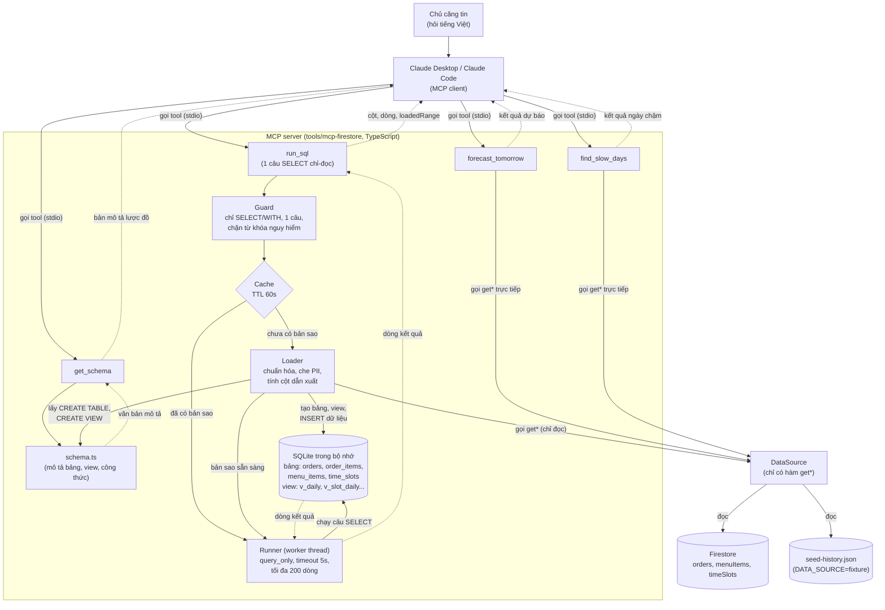

# Thiết kế MCP server báo cáo (cho Antigravity code)

Tài liệu dành cho AI agent (Antigravity). Đọc cùng `docs/analytics-data-plan.md` (các trường dữ liệu và công thức, mục 8) và `docs/data/seed-history.json` (dữ liệu mẫu để test). Mục tiêu: code một **MCP server chỉ-đọc bằng TypeScript** để chủ căng tin hỏi AI (Claude Desktop, Claude Code) bằng tiếng Việt về doanh thu, món bán chạy, khung giờ, hủy đơn, thời gian chuẩn bị, dự báo và thực đơn.

## 0. Ý tưởng cốt lõi (đọc trước khi code)

Server **không map mỗi câu hỏi một công cụ**. Firestore không hỗ trợ SQL, nên server làm một việc đơn giản:

1. Đọc dữ liệu cần thiết từ Firestore (chỉ-đọc) hoặc từ file mẫu.
2. Nạp vào một **CSDL SQLite tạm trong bộ nhớ** với các bảng và view đã chốt sẵn công thức.
3. Cho AI chạy **một câu `SELECT` chỉ-đọc** trên bản sao đó và trả kết quả.

Nhờ vậy AI tự ghép nhóm, lọc, so sánh để trả lời cả những câu chưa ai nghĩ tới. Server luôn tự tính số (SQLite tính), AI không phải cộng trừ từ dữ liệu thô. Công thức chuẩn (doanh thu, tỷ lệ hủy, thời gian chuẩn bị...) nằm cứng trong **bảng và view**, nên cùng một câu hỏi luôn ra cùng một con số.

An toàn dựa trên **hai lớp độc lập**:
- Kết nối Firestore **chỉ có thao tác đọc** (không có đường ghi nào trong mã).
- Câu SQL chỉ chạy trên **bản sao trong bộ nhớ**, đã chặn mọi câu không phải `SELECT`. Dù câu lệnh có lọt qua, cũng không thể chạm vào Firestore.

### Sơ đồ kiến trúc



Bản ảnh của sơ đồ này: `docs/mcp-server-diagram.png` (dùng khi chỗ xem không hiển thị mermaid).

**Cách đọc mũi tên:** mũi tên **liền** nghĩa là *bên trái gọi hoặc ghi sang bên phải* (ví dụ client gọi tool; Runner chạy SELECT trên SQLite; Loader ghi dữ liệu vào SQLite; Loader gọi DataSource để đọc). Mũi tên **đứt** là *kết quả trả ngược về* cho bên đã gọi. Client chỉ gọi được 4 tool, không gọi thẳng Guard, Loader hay Runner. Không có mũi tên liền nào đi vào Firestore theo hướng ghi, và không có đường nào từ SQLite quay lại Firestore.

Luồng một lần gọi `run_sql`:
1. AI (đã đọc `get_schema`) viết câu `SELECT` và truyền khoảng ngày (`date_from`, `date_to`, mặc định 30 ngày gần nhất).
2. **Guard** kiểm tra câu SQL (mục 6.2). Sai thì trả lỗi tiếng Việt, AI sửa và gọi lại.
3. Server tìm trong **cache**; chưa có thì **Loader** đọc `DataSource` trong khoảng ngày, chuẩn hóa dữ liệu và nạp vào SQLite.
4. **Runner** chạy câu SQL trên bản sao ở một worker thread (hết giờ thì dừng worker), giới hạn dòng.
5. Trả về cột, dòng và khoảng ngày đã nạp để AI biết con số áp dụng cho phạm vi nào.

## 1. Mục tiêu và phạm vi

- **Có**: server MCP **chỉ-đọc** chạy **local** (stdio) cho một người dùng tin cậy là chủ căng tin; 4 công cụ ở mục 6 (`get_schema`, `run_sql`, `forecast_tomorrow`, `find_slow_days`); đọc từ Firestore hoặc từ file mẫu.
- **Không**: ghi hoặc xóa dữ liệu, deploy cloud, OAuth, nhiều người dùng, chatbot trong app, kết nối BigQuery.

Quy ước làm việc:
- Làm tuần tự theo mục 10, sau mỗi bước chạy `npm run build` và sửa hết lỗi mới sang bước tiếp.
- Không thêm tính năng ngoài phạm vi. Không sửa nội dung `docs/`, không sửa module Android `app/`.
- Gặp điểm chưa rõ thì chọn phương án đơn giản nhất và ghi chú trong code.

## 2. Stack bắt buộc

- Node 20+, **TypeScript** (`strict`, ES modules, `"type": "module"`).
- `@modelcontextprotocol/sdk` (dùng `McpServer` và `StdioServerTransport`), `firebase-admin`, `zod`, **`sql.js`** (SQLite chạy bằng WASM, không cần biên dịch native; nạp file `.wasm` đi kèm gói).
- Dev: `typescript`, `vitest`, `@types/node`. Build bằng `tsc` ra `dist/`; chạy `node dist/index.js`.
- **Cảnh báo quan trọng**: stdout dành riêng cho giao thức MCP. Mọi log phải ghi ra **stderr** (`console.error`). Tuyệt đối không dùng `console.log` trong server (sẽ làm hỏng kết nối).
- Script `package.json`: `build` (`tsc`), `start` (`node dist/index.js`), `test` (`vitest run`), `dev` (`tsx src/index.ts` nếu cài `tsx`).

## 3. Cấu trúc thư mục

Đặt tại `tools/mcp-firestore/` (ngoài module `app`):

```
tools/mcp-firestore/
├─ package.json, tsconfig.json, README.md, .env.example
├─ src/
│  ├─ index.ts            (tạo McpServer, đăng ký tool, nối stdio)
│  ├─ config.ts           (đọc biến môi trường)
│  ├─ data/
│  │  ├─ types.ts
│  │  ├─ dataSource.ts    (interface DataSource, chỉ có hàm đọc)
│  │  ├─ firestoreSource.ts
│  │  └─ fixtureSource.ts (đọc file mẫu, để test không cần key)
│  ├─ sql/
│  │  ├─ schema.ts        (DDL các bảng + SQL các view + văn bản mô tả lược đồ: NGUỒN SỰ THẬT DUY NHẤT)
│  │  ├─ loader.ts        (DataSource -> bảng SQLite, che PII, tính cột dẫn xuất)
│  │  ├─ guard.ts         (kiểm tra câu SQL)
│  │  ├─ runner.ts        (mở DB, chạy câu SQL trong worker, giới hạn dòng và thời gian)
│  │  ├─ worker.ts        (mã chạy trong worker thread)
│  │  └─ cache.ts         (cache bản sao theo khóa, có TTL)
│  ├─ metrics/            (hàm thuần cho các tool đặc thù)
│  │  ├─ stats.ts         (trung bình, P90, độ lệch chuẩn)
│  │  ├─ forecast.ts
│  │  └─ slowDays.ts
│  ├─ tools/              (getSchema.ts, runSql.ts, forecastTomorrow.ts, findSlowDays.ts)
│  └─ util/               (dates.ts, privacy.ts, format.ts)
└─ test/                  (vitest, chạy trên fixtureSource)
```

Nguyên tắc: tách **dữ liệu → nạp SQL → tool**. `schema.ts` là nơi duy nhất định nghĩa bảng, view và mô tả; `get_schema` và mô tả của `run_sql` đều sinh từ các hằng số trong file này, để tài liệu và mã không bao giờ lệch nhau.

## 4. Nguồn dữ liệu

### 4.1 Kiểu dữ liệu (`data/types.ts`)
```ts
type OrderStatus = 'RECEIVED' | 'PREPARING' | 'READY' | 'COMPLETED' | 'CANCELLED';

interface OrderItem { menuItemId: string; name: string; price: number; quantity: number; category?: string; dishKey?: string; }

interface Order {
  id: string; userId: string; userName: string;
  items: OrderItem[]; slotId: string; slotLabel: string; pickupCode: string;
  status: OrderStatus; total: number; date: string;        // yyyy-MM-dd (giờ VN)
  createdAt: Date; updatedAt?: Date; preparingAt?: Date; readyAt?: Date;
  completedAt?: Date; cancelledAt?: Date;
  cancelledBy?: 'STUDENT' | 'CANTEEN'; cancelReason?: 'SOLD_OUT' | 'OVERLOAD' | 'NO_SHOW' | 'CHANGED_MIND' | 'OTHER';
}

interface MenuItem {
  id: string; name: string; description: string; price: number; imageUrl: string;
  category: string; inStock: boolean; date: string;
  dishKey?: string; tags?: string[]; dailyQuota?: number; soldQty?: number;  // dailyQuota 0 hoặc thiếu = không giới hạn
}

interface TimeSlot { id: string; label: string; startMinute: number; endMinute: number; maxOrders: number; }
```
Đơn cũ có thể thiếu các trường tùy chọn: code phải chịu được (xem mục 5).

### 4.2 Interface
```ts
interface DateRange { from: string; to: string }   // yyyy-MM-dd, gồm cả hai đầu

interface DataSource {
  getOrders(range: DateRange): Promise<Order[]>;        // lọc theo trường `date`
  getMenuItems(range: DateRange): Promise<MenuItem[]>;  // lọc theo trường `date`
  getTimeSlots(): Promise<TimeSlot[]>;
}
```
Interface **chỉ có hàm đọc**; không thêm hàm ghi.

### 4.3 `FirestoreSource`
- Khởi tạo bằng `firebase-admin` với service account đọc từ `SERVICE_ACCOUNT_PATH` (`credential.cert(JSON.parse(...))`).
- Truy vấn: `collection('orders').where('date', '>=', from).where('date', '<=', to)`. Chỉ một trường nên **không cần composite index**. Tương tự cho `menuItems`.
- `getTimeSlots()`: đọc collection `timeSlots`, sắp theo `startMinute`.
- Chuyển mọi `Timestamp` thành `Date` bằng `.toDate()`; trường không có thì để `undefined`.
- Chỉ dùng thao tác đọc (`get()`); không import hay gọi `set`, `update`, `delete`, `add`, `runTransaction`, `batch`.
- Ghi log số tài liệu đã đọc ra stderr (để theo dõi chi phí đọc).

### 4.4 `FixtureSource`
- Đọc `docs/data/seed-history.json` (đường dẫn qua `FIXTURE_PATH`, mặc định tính từ thư mục repo). File có ba mảng `menuItems`, `orders`, `timeSlotCounters`; các trường thời gian là chuỗi ISO, cần đổi sang `Date`.
- File **không có** `timeSlots`. Dựng từ `docs/data/seed-menu.json` (mảng `timeSlots`, hiện có **8 khung**: 4 trưa, 4 chiều tối), sắp theo `startMinute`, gán `id = "slot" + (chỉ số + 1)` (khớp `slotId` mà script sinh dữ liệu dùng ở chế độ dry-run).
- Lọc theo `date` giống `FirestoreSource`.

### 4.5 Chọn nguồn
`DATA_SOURCE=firestore | fixture`, mặc định `firestore`. Nếu chọn `firestore` mà thiếu hoặc sai `SERVICE_ACCOUNT_PATH` thì báo lỗi tiếng Việt rõ ràng và gợi ý "đặt DATA_SOURCE=fixture để chạy thử bằng dữ liệu mẫu".

### 4.6 Giới hạn
Mỗi lần nạp đọc tối đa **92 ngày**; vượt thì trả lỗi yêu cầu thu hẹp khoảng ngày.

## 5. Quy ước chung

- **Ngày giờ**: múi giờ `TIMEZONE` (mặc định `Asia/Ho_Chi_Minh`). "Hôm nay", "hôm qua", "tuần này" (Thứ 2 đến Chủ nhật), "7 ngày qua" tính theo giờ Việt Nam. Tham số `date_from`, `date_to` (yyyy-MM-dd) tùy chọn; mỗi tool ghi rõ mặc định. Thiếu một đầu thì lấy đầu kia. Kiểm tra `from <= to`.
- **Tiền**: VND, số nguyên. **Thời lượng**: phút, làm tròn 1 chữ số thập phân. **Tỷ lệ**: số 0..1.
- **Trạng thái đơn**: chỉ `COMPLETED` tính doanh thu và số suất bán. `CANCELLED` loại khỏi bán ra, thống kê riêng. `RECEIVED`, `PREPARING`, `READY` là đơn đang xử lý: không tính vào doanh thu.
- **Thiếu dữ liệu**: nếu đơn thiếu một trường cần cho phép tính (ví dụ không có `readyAt`) thì cột dẫn xuất tương ứng là **`NULL`** (SQLite tự bỏ qua `NULL` khi `AVG`, `SUM`). Không bao giờ điền số giả.
- **Định danh món**: `dish_key` = `dishKey`; nếu thiếu thì dùng `name`.
- **Quyền riêng tư**: `MASK_PII=true` mặc định. Bảng chỉ có cột `customer` là mã băm ngắn kiểu `khach_a3f` (băm `userId`, lấy 3 ký tự). **Không có cột tên hay `userId` trong bất kỳ bảng nào.** Việc che thực hiện ngay trong Loader, không phụ thuộc câu SQL.
- **Lỗi**: trả `isError: true` kèm thông điệp tiếng Việt dễ hiểu. Không lộ stack trace, đường dẫn tệp key hay nội dung `.env`. Lỗi cú pháp SQL thì trả nguyên thông điệp của SQLite (đã làm sạch đường dẫn) kèm gợi ý "xem lại `get_schema`", để AI tự sửa.
- **Mô tả tool** (`description`) viết bằng tiếng Việt, nói rõ khi nào nên dùng.

## 6. Đặc tả công cụ

Đăng ký bằng `server.registerTool(name, { title, description, inputSchema }, handler)` với `inputSchema` là object `zod`. Kiểu ngày: `z.string().regex(/^\d{4}-\d{2}-\d{2}$/)`.

### 6.1 `get_schema`
- Dùng khi: **luôn gọi đầu tiên** trong một cuộc hội thoại mới trước khi viết SQL.
- Input: không có.
- Output: một khối văn bản (tiếng Việt) sinh từ `sql/schema.ts` gồm: (a) danh sách bảng và cột kèm ý nghĩa, kiểu, đơn vị; (b) danh sách view và công thức; (c) quy ước (mục 5); (d) 6 đến 8 câu SQL mẫu (mục 8.1); (e) khoảng ngày mặc định và giới hạn (30 ngày mặc định, tối đa 92). Cũng đăng ký cùng nội dung này dưới dạng **MCP resource** `canteen://schema` (nếu client hỗ trợ), nhưng không phụ thuộc vào resource vì nhiều client bỏ qua resource.

### 6.2 `run_sql`
- Dùng khi: mọi câu hỏi về doanh thu, món, khung giờ, hủy đơn, thời gian chuẩn bị, thực đơn, và các câu hỏi chưa có tool riêng.
- Input: `sql: string` (bắt buộc, tối đa 4.000 ký tự), `date_from?`, `date_to?` (khoảng ngày để **nạp dữ liệu**, mặc định 30 ngày gần nhất tính đến hôm nay, tối đa 92 ngày).
- `description` của tool phải nói ngắn: "Chạy một câu SELECT (SQLite) trên bản sao dữ liệu căng tin; gọi `get_schema` trước để biết bảng và view; ưu tiên truy vấn trên các view `v_*` vì đã chốt công thức; dữ liệu chỉ gồm khoảng ngày `date_from` đến `date_to`".
- **Guard** (`sql/guard.ts`, chạy trước khi nạp dữ liệu, kiểm bằng test riêng):
  1. Bỏ chú thích (`-- ...` và `/* ... */`) rồi cắt khoảng trắng đầu cuối.
  2. Chỉ **một câu lệnh**: sau khi bỏ `;` cuối, không còn `;` nào ngoài chuỗi ký tự trong dấu nháy.
  3. Câu phải bắt đầu bằng `SELECT` hoặc `WITH` (không phân biệt hoa thường).
  4. Từ chối nếu có (như một từ nguyên vẹn, ngoài chuỗi trong dấu nháy) bất kỳ từ khóa: `INSERT`, `UPDATE`, `DELETE`, `DROP`, `ALTER`, `CREATE`, `REPLACE`, `ATTACH`, `DETACH`, `PRAGMA`, `VACUUM`, `REINDEX`, `ANALYZE`, `BEGIN`, `COMMIT`, `ROLLBACK`, `SAVEPOINT`, `RELEASE`, `LOAD_EXTENSION`.
  5. Vi phạm thì trả `isError` với lý do cụ thể ("Chỉ cho phép một câu SELECT").
- **Runner** (`sql/runner.ts`, `sql/worker.ts`):
  - Mở DB (từ cache hoặc nạp mới), chạy `PRAGMA query_only = ON` (lớp bảo vệ thứ hai, do server chạy, không phải do câu của AI).
  - Chạy câu SQL trong **`worker_threads`**; nếu quá `SQL_TIMEOUT_MS` (mặc định 5000) thì `terminate()` worker và trả lỗi "Câu truy vấn quá lâu, hãy thu hẹp điều kiện".
  - Bọc kết quả để chỉ lấy tối đa `SQL_MAX_ROWS` (mặc định 200) dòng, và đặt `truncated = true` nếu còn nữa (lấy `SQL_MAX_ROWS + 1` dòng để biết).
- **Output** (text: tóm tắt ngắn + khối JSON): `{ columns: string[], rows: any[][], rowCount, truncated, loadedRange: {from, to}, source: 'firestore' | 'fixture', note? }`. Tóm tắt nêu số dòng và khoảng ngày đã nạp. Nếu `rowCount = 0` thì `note` nhắc kiểm tra khoảng ngày và điều kiện lọc.

### 6.3 Bảng, cột và view (định nghĩa trong `sql/schema.ts`)

Tất cả ngày dạng `yyyy-MM-dd`, mọi thời điểm dạng `yyyy-MM-dd HH:MM:SS` **theo giờ Việt Nam** (chuỗi, so sánh và `julianday()` dùng được). Boolean là 0/1. Chỉ nạp dữ liệu trong khoảng ngày của lần gọi.

**Bảng `orders`** (một hàng một đơn)

| Cột | Kiểu | Ý nghĩa |
|---|---|---|
| `order_id` | TEXT | mã đơn |
| `date` | TEXT | ngày đặt |
| `weekday` | INTEGER | 1 = Thứ Hai … 7 = Chủ nhật |
| `week_start` | TEXT | ngày Thứ Hai của tuần chứa `date` |
| `slot_id`, `slot_label` | TEXT | khung giờ nhận, ví dụ `11:30 - 11:45` |
| `daypart` | TEXT | `lunch` (khung bắt đầu trước 14:00) hoặc `evening` (từ 14:00) |
| `status` | TEXT | RECEIVED, PREPARING, READY, COMPLETED, CANCELLED |
| `total` | INTEGER | tổng tiền đơn (VND) |
| `customer` | TEXT | mã băm ngắn của khách, không phải tên |
| `created_at`, `preparing_at`, `ready_at`, `completed_at`, `cancelled_at` | TEXT | các mốc thời gian, NULL nếu chưa có |
| `cancelled_by` | TEXT | STUDENT, CANTEEN hoặc NULL |
| `cancel_reason` | TEXT | SOLD_OUT, OVERLOAD, NO_SHOW, CHANGED_MIND, OTHER hoặc NULL |
| `prep_minutes` | REAL | `ready_at − preparing_at` (phút, 1 chữ số), NULL nếu thiếu mốc hoặc âm |
| `wait_minutes` | REAL | `preparing_at − created_at` (phút) |
| `pickup_delay_minutes` | REAL | `completed_at − ready_at` (phút) |

**Bảng `order_items`** (một hàng một dòng món; đã sao chép các cột của đơn để **không cần JOIN**, tránh cộng trùng tiền)

| Cột | Kiểu | Ý nghĩa |
|---|---|---|
| `order_id`, `date`, `weekday`, `week_start`, `slot_label`, `daypart`, `status` | | sao từ `orders` |
| `dish_key`, `name`, `category` | TEXT | món (`category` thiếu thì `'Không rõ'`) |
| `price`, `quantity` | INTEGER | đơn giá, số suất |
| `line_revenue` | INTEGER | `price × quantity` |

**Bảng `menu_items`** (menu từng ngày, một hàng một món một ngày)

| Cột | Kiểu | Ý nghĩa |
|---|---|---|
| `menu_item_id`, `date`, `weekday` | | |
| `dish_key`, `name`, `category` | TEXT | |
| `price` | INTEGER | |
| `tags` | TEXT | dạng `,vegetarian,filling,` (có dấu phẩy hai đầu; lọc bằng `tags LIKE '%,vegetarian,%'`) |
| `daily_quota` | INTEGER | 0 = không giới hạn |
| `sold_qty` | INTEGER | số suất đã bán trong ngày |
| `remaining_qty` | INTEGER | `daily_quota − sold_qty` (không âm), NULL nếu không giới hạn |
| `in_stock` | INTEGER | căng tin đang bật món |
| `available` | INTEGER | `in_stock = 1` và (`remaining_qty` IS NULL hoặc > 0) |

**Bảng `time_slots`**: `slot_id`, `label`, `start_minute`, `end_minute`, `max_orders`, `daypart`.

**View (công thức đã chốt, ưu tiên dùng):**
```sql
CREATE VIEW v_completed_orders AS SELECT * FROM orders WHERE status = 'COMPLETED';
CREATE VIEW v_completed_items  AS SELECT * FROM order_items WHERE status = 'COMPLETED';
CREATE VIEW v_cancelled_orders AS SELECT * FROM orders WHERE status = 'CANCELLED';

-- Mỗi ngày: doanh thu, đơn, suất, hủy, tỷ lệ hủy, thời gian chuẩn bị trung bình
CREATE VIEW v_daily AS
SELECT o.date, o.weekday, o.week_start,
  SUM(CASE WHEN o.status = 'COMPLETED' THEN o.total ELSE 0 END) AS revenue,
  SUM(o.status = 'COMPLETED')  AS orders,
  (SELECT COALESCE(SUM(i.quantity), 0) FROM order_items i
     WHERE i.date = o.date AND i.status = 'COMPLETED') AS portions,
  SUM(o.status = 'CANCELLED')  AS cancelled_orders,
  SUM(o.status IN ('RECEIVED','PREPARING','READY')) AS in_progress_orders,
  CASE WHEN SUM(o.status IN ('COMPLETED','CANCELLED')) = 0 THEN NULL
       ELSE 1.0 * SUM(o.status = 'CANCELLED') / SUM(o.status IN ('COMPLETED','CANCELLED')) END AS cancel_rate,
  AVG(CASE WHEN o.status = 'COMPLETED' THEN o.prep_minutes END) AS avg_prep_minutes
FROM orders o GROUP BY o.date, o.weekday, o.week_start;

-- Mỗi ngày, mỗi món: số suất và doanh thu (đơn COMPLETED)
CREATE VIEW v_item_daily AS
SELECT date, weekday, dish_key, name, category,
       SUM(quantity) AS portions, SUM(line_revenue) AS revenue
FROM order_items WHERE status = 'COMPLETED'
GROUP BY date, weekday, dish_key, name, category;

-- Mỗi ngày, mỗi khung: số đơn (không tính hủy), tỷ lệ lấp đầy, có đầy không
CREATE VIEW v_slot_daily AS
SELECT o.date, o.weekday, o.slot_id, o.slot_label, o.daypart, t.max_orders,
       COUNT(*) AS orders,
       CASE WHEN t.max_orders > 0 THEN 1.0 * COUNT(*) / t.max_orders END AS fill_rate,
       CASE WHEN t.max_orders > 0 AND COUNT(*) >= t.max_orders THEN 1 ELSE 0 END AS is_full
FROM orders o LEFT JOIN time_slots t ON t.slot_id = o.slot_id
WHERE o.status <> 'CANCELLED'
GROUP BY o.date, o.weekday, o.slot_id, o.slot_label, o.daypart, t.max_orders;

-- Mỗi ngày, mỗi món có hạn mức: tỷ lệ bán, có hết suất không
CREATE VIEW v_item_sellthrough AS
SELECT date, weekday, dish_key, name, category, daily_quota, sold_qty,
       1.0 * sold_qty / daily_quota AS sell_through,
       CASE WHEN sold_qty >= daily_quota THEN 1 ELSE 0 END AS sold_out
FROM menu_items WHERE daily_quota > 0;
```
Lưu ý khi viết SQL (đưa vào `get_schema`): doanh thu của **đơn** dùng `orders.total`; doanh thu của **món** dùng `order_items.line_revenue`; **không** JOIN `orders` với `order_items` rồi cộng `total` (sẽ cộng trùng). Mọi "doanh thu" và "số đơn bán" chỉ tính `status = 'COMPLETED'`. Tỷ lệ hủy = hủy / (hủy + hoàn thành). `time_slots.max_orders` cho biết sức chứa của khung.

### 6.4 Loader (`sql/loader.ts`)
- Nhận `DataSource`, `DateRange`, `TimeSlot[]`; tạo DB mới bằng `sql.js` (`new SQL.Database()`), chạy toàn bộ DDL bảng và view từ `schema.ts`.
- Chuyển dữ liệu theo quy ước mục 5 và 6.3: tính `weekday`, `week_start`, `daypart` (tra `time_slots` theo `slotId`; không khớp thì đọc giờ bắt đầu từ `slotLabel` dạng `HH:mm - ...`), đổi `Date` sang chuỗi giờ VN, tính ba cột phút (NULL nếu thiếu mốc hoặc âm), tách `items[]` thành hàng `order_items`, đóng gói `tags` có dấu phẩy hai đầu, băm `customer`.
- Chèn bằng câu lệnh tham số hóa (`INSERT ... VALUES (?, ?, ...)` trong một giao dịch) cho nhanh.
- Không chèn `userId`, `userName`, `pickupCode` vào bất kỳ bảng nào.

### 6.5 Cache (`sql/cache.ts`)
Khóa = `source|from|to`; giữ bản sao DB trong bộ nhớ `SQL_CACHE_SECONDS` giây (mặc định 60, đặt 0 để tắt). Tối đa 3 mục, loại mục cũ nhất. Lý do: cùng một cuộc hội thoại AI thường gọi `run_sql` nhiều lần liên tiếp với cùng khoảng ngày, không cần đọc lại Firestore mỗi lần.

### 6.6 `forecast_tomorrow`
- Dùng khi: hỏi mai (hoặc một ngày tương lai) nên chuẩn bị bao nhiêu suất mỗi món. Làm riêng vì cần xử lý thống kê theo ngày cùng thứ, khó và dễ sai nếu để AI tự viết SQL.
- Input: `buffer_pct?: number` (mặc định 10, 0 đến 50), `date?` (ngày dự báo, mặc định ngày mai theo giờ VN), `categories?: string[]`, `dish_keys?: string[]`.
- Tính: đọc `menuItems` 5 tuần gần nhất trước ngày dự báo. Với mỗi `dishKey`, lấy `soldQty` của **các ngày cùng thứ** trong tối đa 4 tuần gần nhất. Dự báo = `ceil(trung bình × (1 + buffer_pct/100))`. Ghi `weeksOfData`. Nếu `weeksOfData < 2` thì `forecast: null` kèm `note: "chưa đủ dữ liệu"`. Nếu dự báo > `dailyQuota` hiện tại thì thêm `warning: "vượt hạn mức hiện tại"`.
- Output: `{ forDate, weekday, buffer_pct, items: [{ dishKey, name, forecast, weeksOfData, currentQuota, warning?, note? }] }`.

### 6.7 `find_slow_days`
- Dùng khi: hỏi ngày nào bếp chậm bất thường. Làm riêng vì cần độ lệch chuẩn.
- Input: `date_from?`, `date_to?` (mặc định 30 ngày gần nhất).
- Tính trên đơn `COMPLETED` có `prep_minutes`: trung bình `prep_minutes` theo ngày; **ngày chậm** là ngày có trung bình > (trung bình của các trung bình theo ngày + 1,5 × độ lệch chuẩn của chúng). Cần ít nhất 5 ngày có dữ liệu, ít hơn thì trả `slowDays: []` kèm `note`.
- Output: `{ range, avgPrepOverall, stdDev, slowDays: [{ date, weekday, avgPrep, orders }], daysWithData, skipped }` (`skipped` là số đơn bỏ vì thiếu mốc).

## 7. Cấu hình và chạy

`.env.example` (không commit `.env`):
```
DATA_SOURCE=fixture            # firestore | fixture
SERVICE_ACCOUNT_PATH=          # đường dẫn tới serviceAccount.json (khi dùng firestore)
TIMEZONE=Asia/Ho_Chi_Minh
MASK_PII=true
FIXTURE_PATH=                  # tùy chọn, mặc định ../../docs/data/seed-history.json
SQL_CACHE_SECONDS=60           # 0 = tắt cache
SQL_MAX_ROWS=200
SQL_TIMEOUT_MS=5000
```
`config.ts` đọc biến môi trường (không bắt buộc cài `dotenv`; MCP client truyền env qua cấu hình).

Đăng ký vào **Claude Code**:
```
claude mcp add canteen-report -e DATA_SOURCE=firestore -e SERVICE_ACCOUNT_PATH=/duong/dan/serviceAccount.json -- node /duong/dan/tools/mcp-firestore/dist/index.js
```
Đăng ký vào **Claude Desktop** (`claude_desktop_config.json`), ghi mẫu này vào `README.md`:
```json
{ "mcpServers": { "canteen-report": {
    "command": "node",
    "args": ["/duong/dan/tools/mcp-firestore/dist/index.js"],
    "env": { "DATA_SOURCE": "firestore", "SERVICE_ACCOUNT_PATH": "/duong/dan/serviceAccount.json" } } } }
```
Bảo mật: file key để **ngoài repo** (hoặc tên `serviceAccount.json`, đã nằm trong `.gitignore`); nên dùng service account chỉ có vai trò xem Firestore.

## 8. Câu hỏi mẫu

### 8.1 Câu SQL mẫu (đưa vào `get_schema` và dùng làm bài test)

| Câu hỏi | SQL |
|---|---|
| Hôm qua bán được bao nhiêu? | `SELECT revenue, orders, portions FROM v_daily WHERE date = date('now','+7 hours','-1 day')` |
| Tuần này so với tuần trước? | `SELECT week_start, SUM(revenue) AS revenue, SUM(orders) AS orders FROM v_daily GROUP BY week_start ORDER BY week_start DESC LIMIT 2` (tuần đầu tiên có thể chưa đủ 6 ngày nên khi so sánh phải nói rõ) |
| Món nào bán chạy nhất thứ Sáu? | `SELECT name, SUM(portions) AS portions, SUM(revenue) AS revenue FROM v_item_daily WHERE weekday = 5 GROUP BY dish_key, name ORDER BY portions DESC LIMIT 5` |
| Khung giờ nào hay đầy nhất? | `SELECT slot_label, SUM(is_full) AS full_days, COUNT(*) AS days, AVG(fill_rate) AS avg_fill FROM v_slot_daily GROUP BY slot_label ORDER BY avg_fill DESC` |
| Khung chiều tối có đáng mở không? | `SELECT daypart, AVG(fill_rate) AS avg_fill, SUM(orders) AS orders FROM v_slot_daily GROUP BY daypart` |
| Bao nhiêu đơn hủy, vì sao? | `SELECT cancel_reason, COUNT(*) AS orders FROM v_cancelled_orders GROUP BY cancel_reason ORDER BY orders DESC` |
| Đơn hủy vì quá tải chủ yếu thứ mấy? | `SELECT weekday, COUNT(*) AS orders FROM v_cancelled_orders WHERE cancel_reason = 'OVERLOAD' GROUP BY weekday ORDER BY orders DESC` |
| Bếp chuẩn bị mất bao lâu theo khung giờ? | `SELECT slot_label, AVG(prep_minutes) AS avg_prep, COUNT(prep_minutes) AS orders FROM v_completed_orders GROUP BY slot_label ORDER BY slot_label` |
| Món nào ế (tỷ lệ bán thấp)? | `SELECT name, AVG(sell_through) AS avg_sell_through, SUM(sold_out) AS sold_out_days, COUNT(*) AS days FROM v_item_sellthrough GROUP BY dish_key, name ORDER BY avg_sell_through ASC LIMIT 5` |
| Đồ uống đóng góp bao nhiêu doanh thu mỗi khung? | `SELECT slot_label, SUM(line_revenue) AS revenue FROM v_completed_items WHERE category = 'Đồ uống' GROUP BY slot_label ORDER BY slot_label` |
| Hôm nay có món chay dưới 30k còn suất không? | `SELECT name, price, remaining_qty FROM menu_items WHERE date = date('now','+7 hours') AND tags LIKE '%,vegetarian,%' AND price < 30000 AND available = 1` |

(SQLite không có múi giờ nên `date('now','+7 hours')` là ngày giờ VN; khi sinh `get_schema`, cũng thêm một ghi chú "ngày hôm nay là `<yyyy-MM-dd>`" do server điền sẵn, để AI không phải tự tính.)

### 8.2 Câu hỏi dùng tool riêng
| Câu hỏi | Tool |
|---|---|
| "Mai nên chuẩn bị bao nhiêu suất mỗi món?" | `forecast_tomorrow` |
| "Mai là thứ Hai, nên làm thêm món nào?" | `forecast_tomorrow` (so dự báo với `currentQuota`) |
| "Ngày nào bếp chậm bất thường?" | `find_slow_days` |

### Câu hỏi nằm ngoài khả năng (server phải nói rõ là không trả lời được, không bịa số)
- Hỏi về **một khách cụ thể** ("em Minh Anh hay mua gì?"): chỉ có mã băm, không có tên.
- Hỏi về **lợi nhuận, giá vốn, chi phí nguyên liệu**: dữ liệu chỉ có doanh thu.
- Hỏi về **đánh giá hay mức hài lòng** của học sinh: app không lưu.
- Hỏi về ngày **chưa có dữ liệu** hoặc quá 92 ngày trong một lần nạp: trả thông báo "chưa đủ dữ liệu" hoặc yêu cầu thu hẹp khoảng ngày.
- Yêu cầu **sửa dữ liệu** (đổi giá, hủy đơn, tắt món): server chỉ đọc.

## 9. Kiểm thử và tiêu chí hoàn thành

Test bằng `vitest` trên `FixtureSource` (dữ liệu: `docs/data/seed-history.json`, sinh bằng `node tools/seed-history/seed-history.js --dry-run`; ngày trong file tính theo thời điểm sinh nên **không hardcode ngày hay tổng tiền cụ thể**, hãy tính đối chiếu từ chính file JSON).

**Nạp dữ liệu và công thức**
- [ ] Số hàng `orders` bằng số đơn trong JSON trong khoảng ngày; số hàng `order_items` bằng tổng số dòng món; mỗi bảng không có cột tên hay `userId` (kiểm bằng `PRAGMA table_info` trong test, không phải qua `run_sql`).
- [ ] `SELECT SUM(revenue) FROM v_daily` bằng tổng `total` của đơn `COMPLETED` tính tay từ JSON. `SELECT SUM(line_revenue) FROM v_completed_items` bằng tổng `price × quantity` của các dòng món đơn `COMPLETED` tính tay từ JSON.
- [ ] Số đơn: `COMPLETED + CANCELLED` bằng tổng đơn (dữ liệu mẫu không có đơn đang xử lý); `cancel_rate` nằm trong 0..1; mọi `*_minutes` ≥ 0 hoặc NULL.
- [ ] Khung chiều tối: `daypart = 'evening'` chỉ có các khung từ 17:00; `lunch` cộng `evening` bằng tổng.
- [ ] `v_slot_daily.orders` không bao giờ vượt `max_orders` (dữ liệu mẫu tuân thủ sức chứa).
- [ ] Mọi câu SQL mẫu ở mục 8.1 chạy không lỗi trên dữ liệu mẫu và trả ít nhất một dòng (trừ câu "hôm nay" có thể rỗng).
- [ ] "Xôi thập cẩm" và "Mì xào" nằm trong 3 món có `avg_sell_through` thấp nhất; ngày bếp chậm trong dữ liệu mẫu nằm trong kết quả `find_slow_days`.

**Chống ghi, chống lạm dụng (bắt buộc)**
- [ ] `run_sql` từ chối (trả `isError`) các câu: `INSERT`, `UPDATE`, `DELETE`, `DROP TABLE orders`, `CREATE TABLE x(a)`, `ATTACH DATABASE`, `PRAGMA query_only = OFF`, hai câu nối bằng `;` (`SELECT 1; DELETE FROM orders`), câu rỗng, và `SELECT 1` thì chạy được.
- [ ] Bỏ qua guard (gọi thẳng runner trong test) thì `PRAGMA query_only` vẫn chặn được `DELETE FROM orders`, và bản sao không bị đổi.
- [ ] Câu chạy quá lâu (ví dụ ghép tự thân 3 lần bảng `order_items` bằng `CROSS JOIN` không điều kiện) bị dừng sau khoảng `SQL_TIMEOUT_MS`, server vẫn trả lời các lần gọi sau.
- [ ] `SELECT * FROM order_items` trả tối đa `SQL_MAX_ROWS` dòng và `truncated = true`.
- [ ] Mã nguồn không có `set`, `update`, `delete`, `add`, `runTransaction`, `batch` của Firestore (kiểm bằng `grep` trong test hoặc script), và `DataSource` chỉ có các hàm `get*`.
- [ ] Không có `console.log` ra stdout trong mã nguồn (tìm bằng `grep`).

**Tool đặc thù**
- [ ] `forecast_tomorrow`: với dữ liệu 4 tuần trả dự báo số nguyên cho mọi món; khi chỉ nạp dưới 2 tuần thì `forecast: null` kèm `note`.
- [ ] `find_slow_days`: ngày bếp chậm (trung bình `prep` cao nhất) xuất hiện trong `slowDays`; ít hơn 5 ngày có dữ liệu thì `slowDays` rỗng kèm `note`.
- [ ] `get_schema` chứa tên mọi bảng và view, các câu SQL mẫu, ngày hôm nay, và **không** chứa tên khách hay `userId` mẫu.

**Tích hợp**
- [ ] Cache: hai lần `run_sql` liên tiếp cùng khoảng ngày chỉ gọi `DataSource` một lần (đếm bằng mock); khoảng ngày khác thì nạp lại; `SQL_CACHE_SECONDS=0` thì luôn nạp lại.
- [ ] `npm run build` và `npm test` thành công.
- [ ] Kiểm giao thức: `npx @modelcontextprotocol/inspector node dist/index.js` (với `DATA_SOURCE=fixture`) liệt kê đủ **4 tool** và gọi thử từng tool không lỗi.
- [ ] Nghiệm thu bằng Claude Code hoặc Claude Desktop với dữ liệu thật đã nạp: hỏi ít nhất 8 câu (trộn câu ở 8.1, câu nhiều chiều tự nghĩ ra và câu ngoài khả năng); câu trả lời có số liệu khớp, và câu ngoài khả năng được từ chối rõ ràng.

## 10. Thứ tự làm

1. **Khung dự án**: `package.json`, `tsconfig.json`, `config.ts`, `index.ts` chạy được với một tool tạm `ping` → build, kiểm tra bằng Inspector. *(đã xong)*
2. **Dữ liệu**: `types.ts`, `dataSource.ts`, `fixtureSource.ts`, `util/dates.ts` + test đọc dữ liệu và lọc theo ngày. *(đã xong)*
3. **Lõi SQL**: thêm `sql.js`; viết `sql/schema.ts` (DDL, view, văn bản mô tả), `sql/loader.ts`, `util/privacy.ts` + test nạp dữ liệu và công thức (mục 9, nhóm "Nạp dữ liệu và công thức"). Chưa cần tool, kiểm bằng test.
4. **An toàn và chạy câu SQL**: `sql/guard.ts`, `sql/runner.ts`, `sql/worker.ts`, `sql/cache.ts` + test nhóm "Chống ghi, chống lạm dụng" và cache.
5. **Tool**: `get_schema`, `run_sql` (đăng ký vào server, thay `ping`), chạy Inspector, thử các câu SQL mẫu.
6. **Tool đặc thù**: `metrics/stats.ts`, `forecast.ts`, `slowDays.ts`, `forecast_tomorrow`, `find_slow_days` + test.
7. **`firestoreSource.ts`**, `README.md` (cách chạy, đăng ký MCP), nghiệm thu mục 9 với dữ liệu thật.

Sau mỗi bước chạy `npm run build` và `npm test`; chỉ sang bước sau khi xanh.
